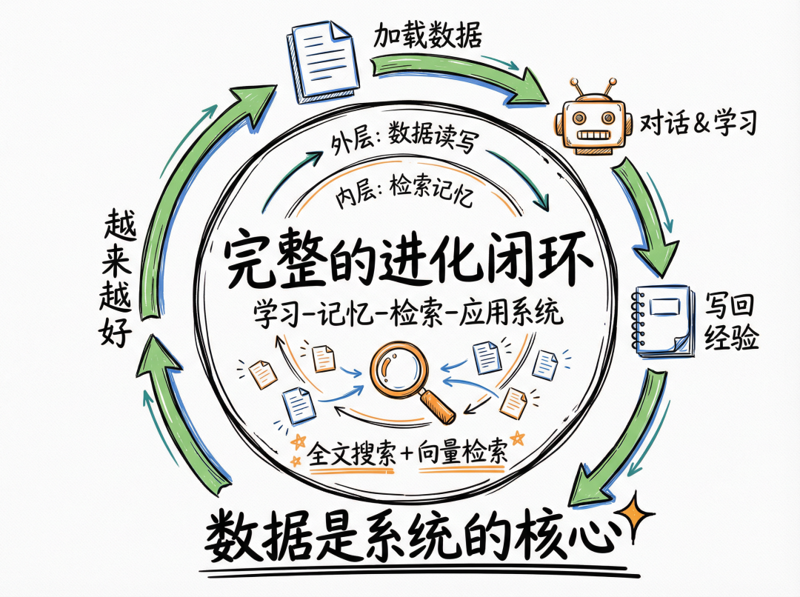
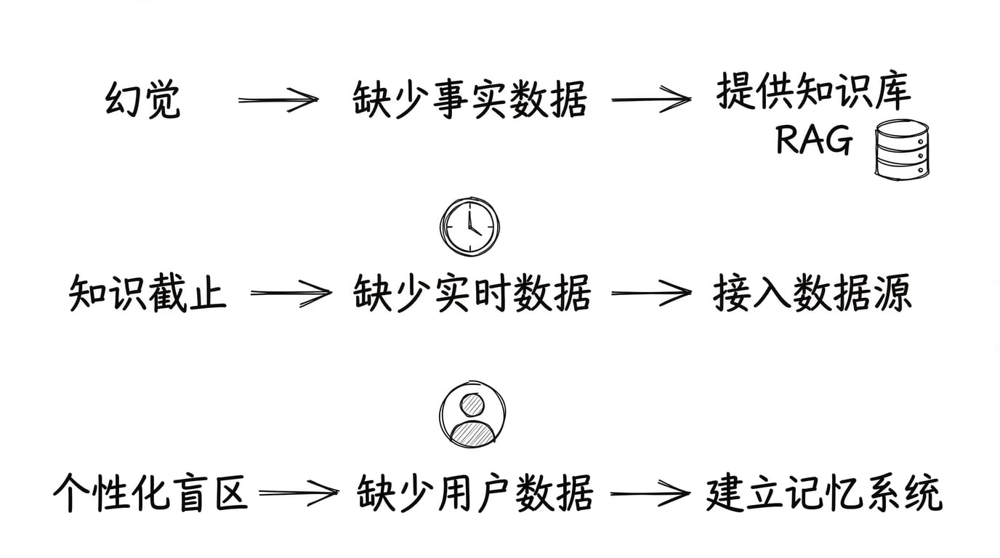
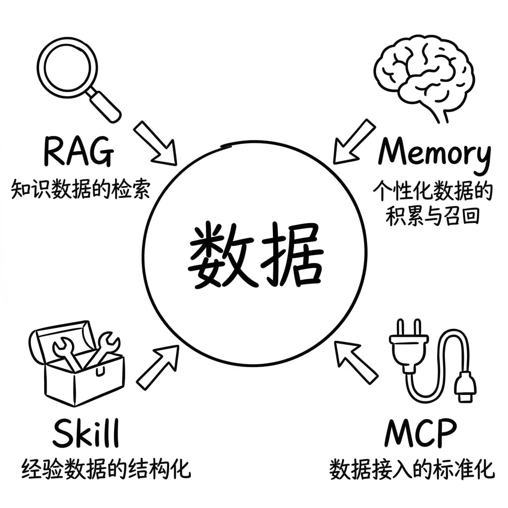
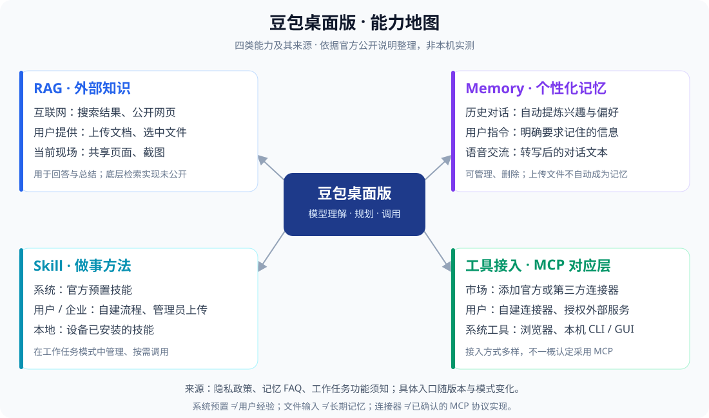

# F0：OpenClaw 为什么越用越好用？

本课作为课程前导，以 OpenClaw 为例，解释 Agent 不好用的常见原因，以及它如何通过积累数据改善表现。核心观点是：框架提供运行能力，模型提供推理能力，用户偏好、业务背景和操作经验则让它更适合你的工作。后续道篇讨论产品判断，术篇讲工程实现。

## 为什么很多人觉得 OpenClaw 不好用？

- **把 Agent 当通才**：所有领域混在一起，经验难以集中；可按需要划分职责，让各 Agent 独立积累工作数据。
- **没有“培训” Agent**：未提供偏好、背景和规范，也不纠正错误，难以形成适合自己的工作方式。
- **模型没选对**：OpenClaw 是框架，底层模型仍需具备理解规则、推理和调用工具的能力。

## 核心机制：自我进化的数据系统

课程将机制概括为：对话前，把相关 Markdown 文件放入 prompt；任务中或结束后，将新知识写回文件。下次任务读取更新后的数据，就能复用已有经验，而不必重新交代背景。

### 骨架：7 类核心数据

OpenClaw 在每个 Agent 的 workspace 中组织：

1. `SOUL.md`：定义人格、语气、风格和边界。
2. `USER.md`：记录用户背景、偏好与工作习惯。
3. `AGENTS.md`：保存行为规范与踩坑教训。
4. `TOOLS.md`：记录设备、路径等环境信息。
5. `SKILL.md`：固化领域流程、规则与输出要求。
6. `memory/*.md`：记录日常任务、对话要点与经验。
7. `MEMORY.md`：从日常记录中提炼长期信息。

还可增加项目记录、模板等自定义文件。原课“无 schema 约束”针对这些额外文件，它们随实际任务逐渐形成。

### 自我进化的闭环

1. **外层读写**：加载数据、执行任务、纠错提炼、写回经验。
2. **内层检索**：历史增多后，利用全文与向量索引按需召回，避免把全部历史塞入上下文。

这意味着：

1. 个性化价值沉淀在用户的数据中。
2. 调教 Agent 包括提供背景、纠错和维护数据。
3. 同样模型下，经验质量会影响使用效果。
4. 持续改善需要知识持久化与检索，而非仅保存聊天记录。

## OpenClaw 实操建议

1. **形成 SOP**：把成熟流程写成可复用 Skill。
2. **审查文件**：及时修正错误与过时信息。
3. **按需分工**：让不同领域分别积累经验。
4. **备份 workspace**：保护数据资产。
5. **选对模型**：用真实任务验证执行能力。

## 课后思考&行动

本节无。

# F1：大模型的本质与边界

本课解释幻觉、知识截止和个性化盲区，建立从数据诊断 AI 效果的思路。模型再强，也需要获得当前任务所需的事实与背景。遇到回答不好，应检查缺少什么数据、数据能否补齐，再判断是否需要更换模型。

## 大模型为什么会“说谎”？

幻觉是指生成内容听起来合理，却包含错误或虚构事实。模型学习文本规律，并逐个预测下一个 Token；这一过程不天然包含事实核验。例如，它知道天空通常是蓝色，却不知道此刻窗外是否下雨。

缺少具体事实时，更强的模型也未必能回答。RAG（检索增强生成）先检索资料，再让模型据此生成答案，能减少无依据的猜测；但资料错误或推理失误仍会导致错误，结果需要核验。

## 大模型不知道的那些事

1. **知识截止**：事件发生与进入训练数据之间存在滞后。最新制度、新闻或业务状态，需要接入更新的数据源。
2. **个性化盲区**：模型未必接触过你的偏好、公司文档或历史决策。回答过于泛化时，应补充用户与业务背景。

## 三个局限，同一个数据视角

课程用“数据质量 × 模型能力”强调两者共同影响效果：幻觉需要可靠事实依据，知识截止需要实时信息，个性化盲区需要用户和业务数据。

实际诊断可问：

1. **缺哪种数据？** 区分事实、实时信息和个性化背景。
2. **卡在模型还是数据？** 观察补资料后效果是否改善。
3. **数据能补吗？** 已有但拿不到，就改善检索；尚不存在，就先采集整理。

## 延伸：Token 与上下文窗口

Token 是模型处理文本的基本单位，上下文窗口限制一次可处理的信息量。窗口变大不等于能有效利用全部信息；RAG 筛选相关资料，记忆系统保存并召回历史，Agent 则把复杂任务拆成多步处理。

## 课后思考&行动

**题目**：找一个 AI 回答不好的问题，判断缺哪类数据；把正确资料贴进对话后，它能否答对？

今天让 coding agent 排查一个 UI bug，它改了几次都说改好了，但我实测问题依然存在。后来让它直接操作浏览器，才发现真正原因。说明它此前缺少页面实际运行状态与交互反馈，仅凭代码推断不足以确认修复。补上浏览器观察，相当于补充任务所需的实时事实数据。

# F2：AI Agent 全景图

本课用模型、规划、记忆和工具解释 Agent 如何执行任务：RAG 补知识，MCP 接外部系统，Skill 提供方法，Memory 复用历史信息。

## 从对话到 Agent：感知、推理、行动

Agent 分解目标、调用工具、观察结果，再决定下一步。例如先查销售数据和营销记录，再分析增长原因。

四个组件分别负责推理、任务拆解、经验召回和查询执行。ReAct 按“推理→行动→观察”循环决策；工作流预设步骤和分支，两者可结合。

课程用“模型能力 × 数据质量 + 编排”强调基础与执行组织的作用，是概念表达。

## Agent 能力地图

1. **RAG——查资料**：朴素 RAG 按“检索→拼接→生成”执行；Agentic RAG 可判断查哪里、查几次。效果受文档质量、切分、检索策略和嵌入模型影响。
2. **MCP——统一接入**：标准化工具、资源和提示模板。框架与工具各实现协议适配，减少逐对集成；工具本身的质量仍需保证。
3. **Skill——复用经验**：把操作流程、领域规则、案例和术语组织为可执行方法。关键在于写清楚、找得到、能复用。
4. **Memory——积累与召回**：事实偏好属语义记忆，历史经历属情景记忆，做事方法属程序性记忆；工作记忆承载当前任务信息。效果取决于提炼、召回和遗忘机制。

## 统一数据引擎

Agent 需要向量检索找语义、全文检索匹配关键词、关系查询筛选条件。多个系统会增加同步与运维成本。课程以 seekdb 展示统一数据层，以 PowerMem 封装记忆管理；后续道篇讨论数据决策，术篇实现并验证效果。

## 课后思考&行动

**题目**：画产品能力地图，说明四类能力、知识来源、记忆存储、技能管理和接入协议；判断缺口是无数据、检索不到还是格式不对。

以豆包桌面版为例：

