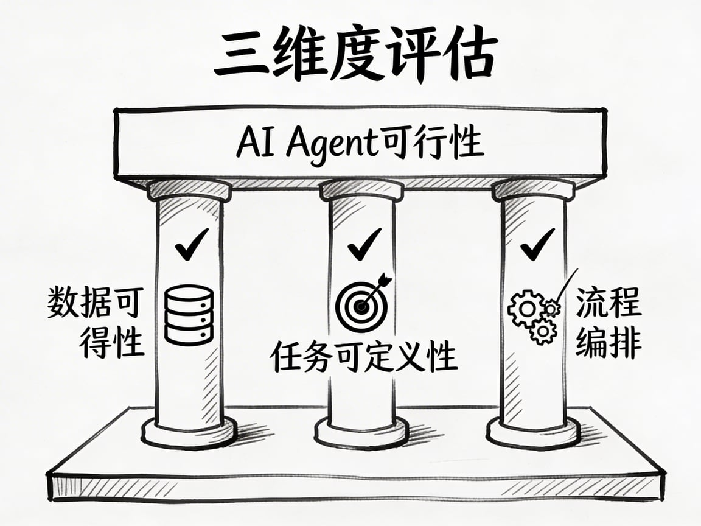
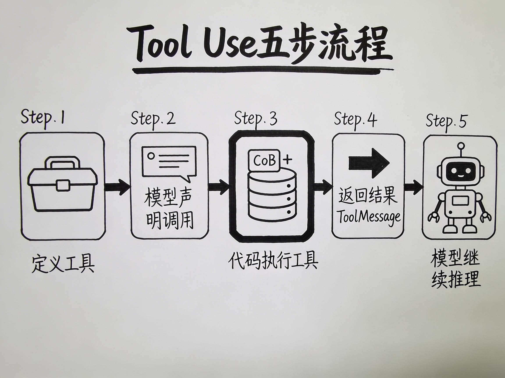
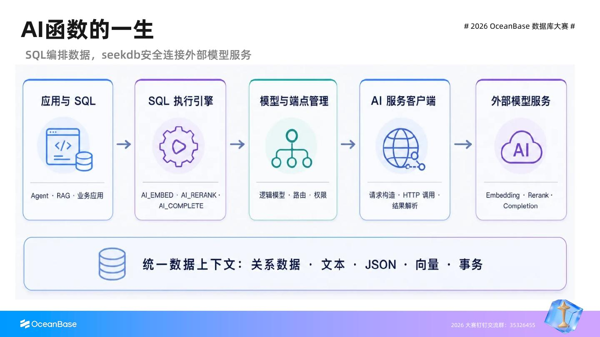

# P1：AI Agent 场景识别

本课讨论“值不值得做 Agent”。论坛助手升级模型后效果未改善，补全并更新知识库才解决问题，说明立项前应先定位数据缺口。判断既要看任务是否需要智能，也要看数据、成功标准和流程是否准备好。

## 哪些场景不需要 Agent？

1. 固定 FAQ：答案明确，优先用页面或搜索。
2. 精确指标查询：意图与口径确定，优先用 SQL、BI 看板。
3. 精确计算：直接用公式或程序，减少不确定环节。

## 三维度可行性评估

1. **数据可得性**：答案是否存在、准确、可处理且有权限接入？先用 10 个典型问题查数据。
2. **任务可定义性**：什么算做对？有事实依据时核对正确性；创意等主观任务需人工评分或盲测基线，明确谁评、多久评。
3. **流程编排选择**：Agent 自主决定步骤；Workflow 由人设计流程。按数据条件、任务确定性和错误代价选择，高风险环节保留人工审核。

## 场景评估 Checklist

依次检查场景匹配、数据可得、成功标准和控制方式。课程建议：10 题中过半找不到答案，先建数据；标准不清，先调研；固定流程优先 Workflow。可从人主导、AI 辅助，逐步走向 AI 执行、人审核，再增加自主性。

## 什么问题适合交给 Agent？

三个甜区：理解模糊意图、组合外部工具、多轮持续交互。命中甜区只说明有潜在价值，不代表已具备上线条件。

本地部署还涉及隐私与信任：运行在本机不等于数据不外传，仍要检查模型和工具的数据流向。

## 课后思考&行动

**题目**：选择一个 AI 需求，列 10 个问题，检查答案位置、准确性与可接入性，统计立即可用比例，判断应投入模型层还是数据层。

拿“内部报销助手”举个例子。假设我先查了 10 个常见问题，发现数据准备情况是这样的：

| 问题 | 答案数据与状态 |
| --- | --- |
| 差旅标准？ | 现行制度，可用 |
| 发票要求？ | 财务指南，可用 |
| 提交入口？ | 流程文档，可用 |
| 必填材料？ | 材料清单，可用 |
| 审批步骤？ | 审批流程，可用 |
| 报销时限？ | 现行制度，可用 |
| 特殊补贴？ | 仅口头规则，需整理 |
| 海外标准？ | 旧版制度，需更新 |
| 当前审批人？ | 组织接口未接入 |
| 本单处理进度？ | 工单接口未接入 |

这 10 个问题里，只有 6 个能直接回答，另外 4 个不是换个模型就能解决的。我会先把规则补齐、制度更新好，再接上审批和进度查询。第一版先做制度问答，拿不准就转人工，不急着让它自动审批。等资料齐了，再看引用是否准确、用户的问题有没有解决，才知道还需不需要换模型。

# D1：大模型 API 工程化基础

本课用 LangChain 串起消息列表、流式输出和 Tool Use。LangChain 是大模型应用开发框架，统一模型调用、消息和工具接口，减少接入与编排代码。模型负责决定调用什么，程序负责执行并回传结果，Agent 据此继续推理。

## 用 LangChain 调用 Chat 模型：对话是一个列表

消息包含角色和内容：system 规定行为，user 提问，assistant 回复。多轮对话靠程序维护并重传历史，受上下文窗口限制。LangChain 提供统一的调用和响应接口，但不会自动解决历史管理。

## Streaming：减少等待感

普通调用完成后才返回，流式调用逐块显示。关注首 Token 延迟与总时长；逐步呈现不保证推理更快。

## Tool Use：从“只能说”到“能做事”

1. 定义工具：函数名表示能力，描述说明何时用，参数类型形成调用约束。
2. 绑定工具：把可用工具提供给模型。
3. 模型声明：返回工具名、参数和调用标识。
4. 程序执行：查询数据库、读文件或调用接口。
5. 回传结果：模型继续推理，必要时再次调用工具。

一轮可能有多个调用，必须逐个处理；保存模型的调用消息，再用匹配调用 ID 的工具消息回传。持续使用绑定工具的模型，直到无工具调用，并设置轮数上限。工具描述影响选择，执行权限与数据质量仍由程序控制。

## 从手动编排到 Agent 循环

六个示例依次覆盖基础调用、多轮对话、流式输出、模拟检索、seekdb 真实检索、框架化 Agent。前五步帮助理解调用链，第六步封装循环；封装不替代权限、失败处理和验证。选择服务时应确认支持工具调用消息协议。

## 课后思考&行动

**题目**：配置环境，运行 d1_1～d1_5；附加体验 d1_6，比较手动循环与框架封装。

我这次使用 `.venv` 虚拟环境，把项目依赖和系统 Python 隔开，模型改用 `deepseek-v4.1-flash`。切换模型不只是改名字，还要对上服务地址、密钥，并确认工具调用协议兼容。

练习时，我会先看基础调用能否返回，再对比带历史和不带历史的区别、流式和一次性返回的区别。模拟检索重点看：模型有没有提出调用、代码有没有执行、结果有没有回给模型。接入 seekdb 后，再看答案是否真的用到了检索内容。

手动版要自己维护消息、执行工具和控制循环；框架版把这些步骤封装起来。理解了手动流程，就更容易定位“没调工具”或“查了却答不好”到底卡在哪一步。

# I3：SQL × AI——AI Functions 的设计与执行

本课解释 SQL 调用外部模型的机制与风险：数据库管理数据和权限，应用组织交互与流程。

## 四个核心函数

| 函数 | 职责 |
| --- | --- |
| AI_EMBED | 文本向量化 |
| AI_RERANK | 有限候选精排 |
| AI_COMPLETE | 摘要、抽取、生成 |
| AI_PROMPT | 本地替换模板并组装 JSON，不调用模型 |

前三者调用远程模型；模板函数不防注入，也不保证合法输出。

## 执行链路与模型配置

校验参数→解析模型与权限→选端点→适配协议→HTTP 请求→解析结果。逻辑模型定义能力，端点配置地址与凭据，适配器处理协议；各函数兼容性需分别验证。

## 组织检索与生成

查询向量只生成一次并复用；权限过滤、召回融合后，重排有限候选，再根据证据生成。保留来源与权限，不混用向量空间。

## 请求数、失败与事务边界

一条 SQL 可触发多次请求。先物化小候选集；限流可有限重试，输入和权限错误先修正。

推理与费用不能随事务回滚。采用“短事务固化输入→事务外推理校验→短事务写回”，记录幂等键、状态和版本。

## 安全、输出与选型

分离调用与管理权限，保护凭据、脱敏、防注入；HTTP 成功仍需校验业务结果。

小集合加工适合 SQL；长任务和复杂交互更适合任务系统或 SDK。

## 课后思考&行动

**题目**：设计不超过 20 条评论的加工实验，覆盖配置、向量化、重排、摘要、校验、指标与失败注入。

我会先拿 20 条评论做小实验。表里保留 ID、租户、正文、哈希、向量、版本和处理状态，再配好嵌入、重排、生成模型的端点。

先用短事务固定输入，事务外生成向量，校验维度后再写回。查询时按租户找候选，重排后保留来源，再让模型生成摘要。摘要要检查结构、枚举和依据，同时记录请求数、P95 延迟、重试与费用。

再模拟 429 和非法响应：看重试会不会停下来，坏结果会不会混进正式数据。不能只看“接口返回成功”。

**题目**：回答六个执行与设计问题。

1. UPDATE 内推理为何危险？等模型时可能一直占着锁，回滚也退不回推理费。
2. 查询向量为何复用？同一个问题没必要反复付费计算。
3. 重排为何保留 ID 等字段？排完还得知道内容来自哪、版本对不对、用户能不能看。
4. 双层重试有何后果？两边都重试，请求和费用可能成倍增加。
5. 何时重算历史？嵌入模型或维度变了要重建向量；提示或生成模型变了，先评测再决定重做哪些结果。
6. 何时用 SDK？需要流式、多轮或复杂编排时，放应用层更顺手。
