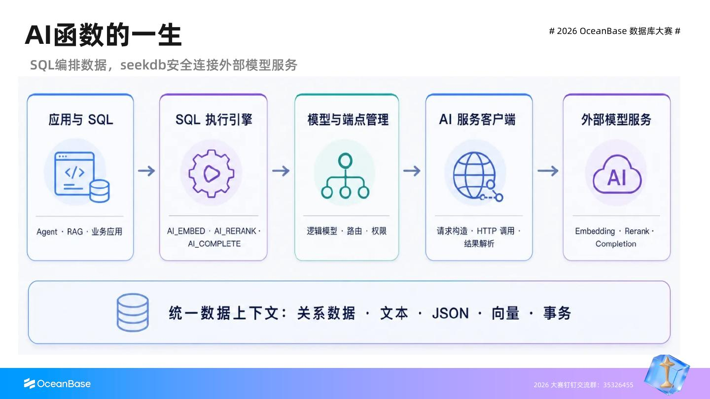

# Task 4：统一 AI Native 数据层实战

本次围绕 D2《AI 应用的数据层》和 I3《SQL × AI》展开：D2 用 seekdb 完成切分、向量化和混合检索；I3 进一步说明如何在 SQL 中受控地调用 Embedding、重排和生成模型。

## D2：AI 应用的数据层

### 从文档到可检索数据

RAG 入库先切分，再为每个 Chunk 生成 Embedding。切分应尽量保留标题、段落等语义边界，并保存来源、版本和权限等元数据。固定 overlap 适合快速起步；动态 overlap 可保护高风险边界；语义分块按话题变化切分；父子 Chunk 用小块召回、用父块提供完整上下文，适合检索准但回答缺上下文的情况。

### 向量、全文与关系过滤

向量搜索擅长同义表达和语义近似，但可能把相似错误码或版本混淆；全文搜索能精确命中错误码、型号和专有名词；关系过滤按租户、版本、状态等缩小范围。三者解决不同问题，混合检索把多路结果合并，避免在应用层维护独立数据库与同步逻辑。

### d2_1–d2_5 运行记录

| 脚本 | 实际结果 |
| --- | --- |
| `d2_1_ingest.py` | 使用 `text-embedding-bge-m3`；8 篇原文切成 8 段并全部写入 seekdb。 |
| `d2_2_vector_search.py` | 语义查询命中 RBAC/访问控制相关文档；错误码 E-4012 排在 E-4013、E-4011 前。 |
| `d2_3_hybrid_search.py` | 混合检索命中 E-4012；语义查询命中访问控制；版本过滤返回 `version=4.2` 结果。 |
| `d2_4_compare.py` | 错误码、权限设计和性能优化查询均找到对应内容；比较显示混合检索能结合精确词项与语义结果。 |
| `d2_5_chunking_compare.py` | 固定 overlap、动态 overlap、父子 Chunk、语义分块的 Recall@3 均为 100%；块数分别为 5、6、9、2，平均长度为 186、185、104、396 字。 |

四种分块策略在这组查询上都达到满召回，不能据此认定效果等同；当前数据量小，需增加真实问题并关注上下文完整性、延迟与成本。运行记录还显示 D2 的 21 项单元测试通过。

## I3：SQL × AI —— AI Functions 的设计与执行

AI Functions 在 SQL 中调用模型，适合小批量、边界清晰的数据加工；可能触发远程请求、延迟、失败、重试和费用。

| 函数 | 职责 | 是否远程调用 |
| --- | --- | --- |
| `AI_EMBED` | 文本向量化 | 是 |
| `AI_RERANK` | 对有限候选重排 | 是 |
| `AI_COMPLETE` | 调用模型生成文本 | 是 |
| `AI_PROMPT` | 按模板组装 Prompt JSON | 否 |

调用先校验参数，再解析逻辑模型、检查权限、适配 Provider 与端点，最后发 HTTP 请求并解析响应。逻辑模型与端点分离便于管理；切换模型仍须记录版本并回归评测。逐行调用会放大请求数，应先过滤和限量。

外部推理不受事务回滚：回滚只能撤销本地数据，不能撤回请求或费用。批任务宜短事务固化输入、事务外调用、校验后短事务写回；保护凭据、脱敏数据并校验输出。

### 思考题

1. **题目：为什么 `AI_COMPLETE` 出现在 `UPDATE` 中会放大事务风险？**

   **回答：** `UPDATE` 会逐行计算表达式，20 条记录就可能触发约 20 次远程 Completion。远程请求比本地 SQL 慢得多，事务和锁可能在等待期间一直占用；若第 12 次请求超时，前 11 次模型调用已经发生，数据库回滚也无法撤销这些请求或费用。更稳妥的流程是先用短事务选出并固化待处理记录及输入快照，在事务外分批调用模型，再校验每条结果，最后用短事务按记录 ID 写回。这样能缩短锁持有时间，也便于失败后从明确状态恢复。

2. **题目：同一查询向量为什么应先保存到变量或中间结果？**

   **回答：** `AI_EMBED` 会访问模型端点，调用有延迟，也可能计费；它不像本地算术表达式那样可以默认视为零成本。若同一条 SQL 在多个子句中重复写 `AI_EMBED(查询文本)`，执行器是否复用计算结果还取决于执行计划，可能重复调用。先把查询向量生成一次并保存到变量、临时表或中间结果，再用它做距离计算，能把调用次数变得可控，方便记录模型版本和排查延迟，也避免重复请求消耗资源。

3. **题目：Rerank 对象数组为什么要保留 ID、版本和权限字段？**

   **回答：** Rerank 通常只对输入候选排序，返回的是候选位置或分数；调用方需要用稳定 ID 把排序映射回数据库中的原始记录。版本字段能说明被排序的是哪个版本的文档，避免内容更新后分数对应到旧证据；租户、权限字段则用于限制候选范围，并在取回结果时再次核验授权。传给模型的对象应保留这些必要元数据，但最终身份和权限仍以数据库记录为准，不能采信模型生成或改写的 ID、租户、授权结论。

4. **题目：数据库内部重试和应用重试叠加会产生什么后果？**

   **回答：** 假设数据库内部最多重试 3 次，应用又把 SQL 最多重试 3 次，最坏情况可能放大到 9 次底层请求；实际次数取决于各层的重试定义和错误类型。更棘手的是超时只说明调用方没及时收到结果，不代表模型端没有完成，于是重复执行可能再次计费、生成不同答案，甚至造成重复写入。应明确各层的总尝试预算和退避策略，只对可恢复错误重试；为任务设置幂等键、状态表和唯一约束，并记录每次尝试，避免把重试变成无边界的重复工作。

5. **题目：哪些模型配置变化会迫使你重算历史数据？**

   **回答：** Embedding 模型、模型版本、输出维度、文本清洗或前缀模板变化，都可能改变向量的数值分布或语义空间。旧文档向量与新查询向量混用时，距离分数不再有可靠可比性，因此应在记录中标记嵌入版本，批量重算历史向量，并按新维度或配置重建索引，再用固定评测集验证召回。Rerank 或 Completion 模型、端点和 Prompt 模板变化一般不要求重算文档向量，但会改变排序或生成结果；仍需记录版本、运行回归问题集，并比较效果、延迟与成本后再切换。

6. **题目：什么情况下直接使用模型 SDK 比 AI Functions 更合理？**

   **回答：** 如果任务需要多轮上下文、Tool Calling、流式输出、多模态输入、长流程 checkpoint、细粒度限流/熔断，或要在多个 Provider 间做负载均衡与故障切换，应用 SDK 或工作流框架通常更好控制，也更容易观测每一步状态。AI Functions 更适合数据量受控、输入结构化、与数据库筛选紧密相连的轻量加工。选择时还要看失败恢复和事务边界：SQL 回滚只能回滚本地数据，无法撤销已经发出的模型请求，因此副作用复杂或调用时间长时，应把模型调用移到应用层编排。

### 课后行动实验：产品评论智能加工

**题目**：用不超过 20 条评论验证 SQL AI Functions 的请求、事务与失败边界，记录请求量、P95、重试和费用；并在可控条件下验证 429 与非法响应的处理。

建立评论表并配置逻辑模型与端点。用 `AI_EMBED` 入向量，SQL 过滤后召回候选并用 `AI_RERANK`，再用 `AI_PROMPT` + `AI_COMPLETE` 生成结构化摘要。固化输入快照，在事务外调用，校验 JSON 后短事务写回。若 Provider 或网关提供故障注入能力，可注入 429 和非法响应，检查重试预算、失败状态和未验证结果不落表。

**运行结果：** 实验工程见 [README](experiment/task/README.md)，完整报告见 [results/latest.json](experiment/task/results/latest.json)。seekdb embedded 1.4.1 使用 `.env` 中配置的真实本地模型端点，处理了 12 条评论，执行 13 次 `AI_EMBED`、1 次 `AI_PROMPT` 和 2 次 `AI_COMPLETE`；向量召回 Top 3 为评论 10、8、12，生成摘要通过 JSON 与字段校验。本次记录 13 个计时样本，P95 为 4113.86 ms；事务回滚后本地摘要字段未写入。当前可用服务未提供 Rerank 接口，因此 `AI_RERANK` 调用数为 0，实验尚未覆盖真实重排、429 重试和非法响应故障；本报告也未采集 Provider 用量与价格，不能据此计算费用。
